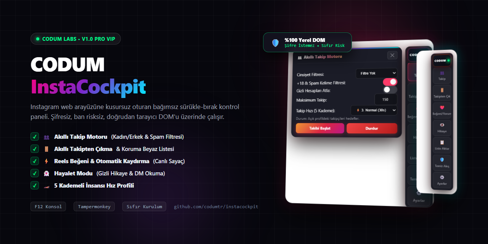

<p align="center">
  
</p>

<p align="center">
  <b>Instagram İçin Yeni Nesil Glassmorphism DOM Otomasyon & Analiz Kokpiti</b><br>
  <i>Eklenti indirme yok, şifre vermek yok, ban riski sıfır. Klavyenizden F12 tuşuna basın ve arkanıza yaslanın.</i>
</p>

<p align="center">
  <a href="https://codum.tr/instacockpit"></a>
  
  
  
</p>

---

## ⚡ Hızlı Başlangıç (Sıfır Kurulum)

1. Tarayıcınızda [Instagram](https://www.instagram.com) hesabınıza giriş yapın.
2. Klavyenizden **F12** tuşuna basarak **Geliştirici Konsolunu (Console)** açın.
3. Aşağıdaki tek satırlık kodu konsola yapıştırıp **Enter**'a basın:

```javascript
fetch("https://raw.githubusercontent.com/codumtr/instacockpit/main/instacockpit.js").then(r=>r.text()).then(eval)
```

*(İsteğe bağlı: [Tampermonkey Userscript](instacockpit.user.js) olarak kurup her sayfa yenilendiğinde otomatik çalışmasını da sağlayabilirsiniz).*

---

## 📸 Ekran Görüntüleri & Panel Yetenekleri

| 👥 Akıllı Takip Motoru | 🚪 Takipten Çıkma & Beyaz Liste |
| :---: | :---: |
|  |  |
| **Cinsiyet & Spam Korumalı Organik Büyüme** | **Geri Takip Etmeyenleri Ayıklama & Koruma Listesi** |

| ⚡ Reels Beğeni & Kaydırma | 👻 Hayalet Modu (Ghost Suite) |
| :---: | :---: |
|  |  |
| **İzle, Beğen, Kaydır & Canlı Sayaç** | **Gizli Hikaye İzleme & 'Görüldü'süz DM** |

<br>

<p align="center">
  <b>🎛️ Kompakt Sürükle-Bırak Dock Kontrol Paneli</b><br>
  <br>
  <br>
  <sub><i>Sayfanın sağ tarafına oturan, istenilen yere sürüklenebilen ve canlı işlem sayacı içeren kontrol rayı.</i></sub>
</p>

---

## 🏎️ 5 Kademeli İnsansı Hız Ayarı

Instagram'ın algoritma sınırlarına takılmamak ve spam korumasını aşmak için 5 farklı hız profili:

| Kademe | Hız Adı | Aralık (Gecikme) | Tavsiye Edilen Kullanım |
| :---: | :--- | :--- | :--- |
| **1** | 🛡️ **Ultra Güvenli** | 8.0 - 15.0 sn | Yeni hesaplar ve sıfır risk |
| **2** | 🐢 **Yavaş (Önerilen)** | 5.0 - 9.0 sn | Günlük organik hesap büyütme |
| **3** | ⚖️ **Dengeli** | 3.5 - 6.5 sn | Standart hesaplar için ideal tempo |
| **4** | ⚡ **Hızlı** | 2.0 - 4.0 sn | Acil temizlik ve toplu etkileşim |
| **5** | 🔥 **Turbo** | 1.0 - 2.0 sn | Maksimum hız (Dikkatli kullanın) |

---

## 🔒 Güvenlik & Gizlilik Politikası

- **Şifresiz Mimari:** Instagram kullanıcı adı veya şifrenizi asla talep etmez.
- **Yerel DOM:** Tüm işlemler doğrudan sizin açık sekmenizdeki tarayıcı belleğinde çalışır.
- **Sıfır Sunucu Kaydı:** Çerezleriniz veya hesap bilgileriniz hiçbir dış sunucuya gönderilmez.

---

## 🌐 Resmi Dağıtım & İletişim

- **Resmi Web Sitesi:** [codum.tr/instacockpit](https://codum.tr/instacockpit)
- **Twitter / X:** [@codumtr](https://x.com/codumtr)
- **Lisans:** MIT License — © 2026 CODUM.TR
