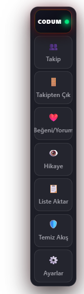
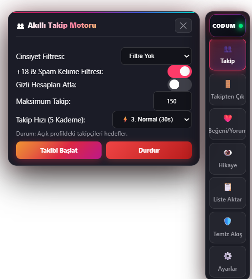
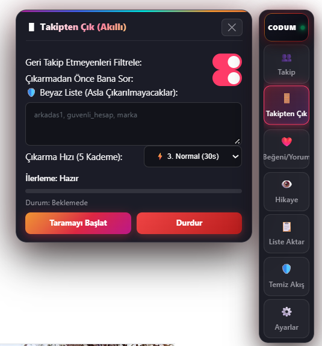
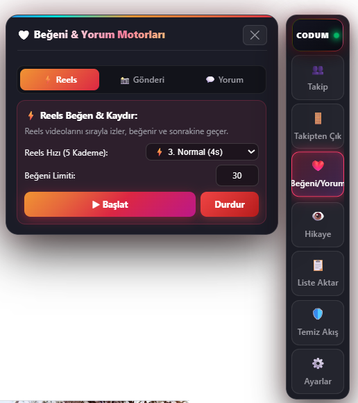
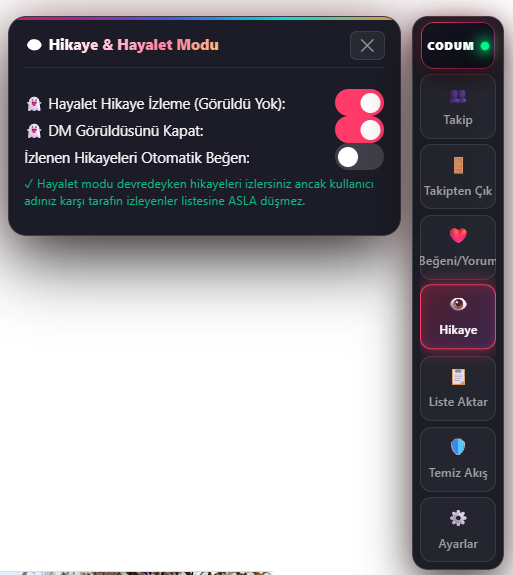

# 🚀 CODUM InstaCockpit (v1.0.0 Pro)

<p align="center">
  
</p>

<p align="center">
  <b>Instagram İçin Modern Glassmorphism DOM Otomasyon & Analiz Kokpiti</b><br>
  <i>Eklenti indirme yok, şifre vermek yok, ban riski sıfır. Klavyenizden F12 tuşuna basın ve arkanıza yaslanın.</i>
</p>

<p align="center">
  <a href="https://codum.tr/instacockpit"></a>
  
  
  
</p>

---

## ⚡ Hızlı Başlangıç (Sıfır Kurulum)

1. Tarayıcınızda [Instagram](https://www.instagram.com) hesabınıza giriş yapın.
2. Klavyenizden **F12** tuşuna basarak **Geliştirici Konsolunu (Console)** açın.
3. Aşağıdaki tek satırlık kodu yapıştırıp **Enter**'a basın:

```javascript
fetch("https://raw.githubusercontent.com/codumtr/instacockpit/main/instacockpit.js").then(r=>r.text()).then(eval)
```

*(İsteğe bağlı: [Tampermonkey Userscript](instacockpit.user.js) olarak kurup her sayfa yenilendiğinde otomatik çalışmasını da sağlayabilirsiniz).*

---

## ✨ Temel Yetenekler & Özellikler

### 1. 👥 Akıllı Takip Motoru (Smart Follow Engine)


- **Cinsiyet Filtresi:** Kadın veya Erkek profil tespitiyle hedef kitlenizi organik olarak takip eder.
- **Spam & +18 Koruması:** Şüpheli kelimeleri ve bot hesapları otomatik atlar.
- **Gizli / Açık Hesap Ayrımı:** İsteğe bağlı sadece açık veya sadece gizli hesapları hedefler.

### 2. 🚪 Takipten Çıkma & Beyaz Liste (Smart Unfollow)


- **Geri Takip Etmeyenleri Ayıklama:** Sizi takip etmeyenleri anında tespit eder.
- **Beyaz Liste (Whitelist):** Yakın arkadaşlarınızı ve korumak istediğiniz hesapları asla takipten çıkarmaz.

### 3. ⚡ Reels Beğeni & Otomatik Kaydırma (Reels Autopilot)


- Reels videolarını insan hızında izler, kalp atar, teyit alır ve otomatik olarak sonrakine geçer.
- Sağdaki dock üzerinden **tek tıkla pencere açmadan anında durdurma** ve canlı sayaç.

### 4. 👻 Hayalet Modu (Ghost Suite)


- **Gizli Hikaye İzleme:** Kullanıcı adınız hikayeyi görenler listesine ASLA düşmez.
- **Gizli DM Okuma:** Karşı tarafa 'Görüldü' işareti göndermeden mesajları okuyun.

---

## 🏎️ 5 Kademeli İnsansı Hız Ayarı

Instagram'ın algoritma sınırlarına takılmamak için 5 farklı hız profili sunulur:

| Kademe | Hız Adı | Aralık (Gecikme) | Tavsiye Edilen Kullanım |
| :--- | :--- | :--- | :--- |
| **1** | 🛡️ **Ultra Güvenli** | 8.0 - 15.0 sn | Yeni açılmış hesaplar ve sıfır risk |
| **2** | 🐢 **Yavaş (Önerilen)** | 5.0 - 9.0 sn | Günlük organik hesap büyütme |
| **3** | ⚖️ **Dengeli** | 3.5 - 6.5 sn | Standart hesaplar için ideal tempo |
| **4** | ⚡ **Hızlı** | 2.0 - 4.0 sn | Acil temizlik ve toplu etkileşim |
| **5** | 🔥 **Turbo** | 1.0 - 2.0 sn | Maksimum hız (Dikkatli kullanın) |

---

## 🔒 Güvenlik & Gizlilik Politikası

- **Şifre İstemez:** Instagram kullanıcı adı veya şifrenizi asla talep etmez.
- **Yerel DOM Çalışması:** Tüm işlemler doğrudan sizin kendi açık sekmenizdeki tarayıcı DOM'u üzerinde çalışır.
- **Sıfır Sunucu Kaydı:** Verileriniz, oturum çerezleriniz veya hesap bilgileriniz hiçbir harici sunucuya iletilmez.

---

## 🌐 Resmi Dağıtım & İletişim

- **Resmi Web Sitesi:** [codum.tr/instacockpit](https://codum.tr/instacockpit)
- **Twitter / X:** [@codumtr](https://x.com/codumtr)
- **Lisans:** MIT License — © 2026 CODUM.TR
